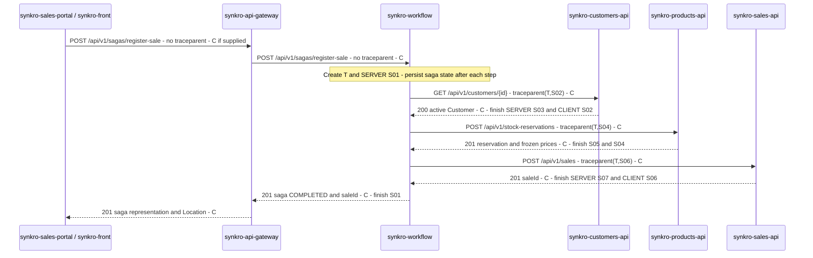

# CP1 - Critical journey and trace propagation

## Journey and scope

**Journey:** Register a sale with customer validation and stock reservation.
An authenticated ADMIN or SALESPERSON starts the operation from `synkro-sales-portal`, using the HTTP client provided by `synkro-front`.
The gateway routes the request to `synkro-workflow`, which validates the customer, reserves all lines atomically and registers the sale.
This journey supports the product goal of accurate stock and traceable sales; the measured request starts at the gateway and ends with the saga response.
The main trace below covers completion within the initial HTTP request. Polling and restart recovery are separate cases.

**Status:** This is the workshop's instrumentation design, not evidence that these spans already exist in the deployed services.
Existing contracts define `X-Correlation-Id`; CP1 adds W3C `traceparent` propagation alongside it.
The gateway is a transparent trace-context carrier in this design; no NGINX tracing module or gateway span is assumed.

## Hop table

All paths below include the `/api/v1` server prefix from the OpenAPI contracts.
`C` denotes the unchanged `X-Correlation-Id`; `T` denotes the distributed trace ID.

| # | Caller | Receiver | Protocol | Operation | Sync/async | Data accessed by receiver | Trace context |
|---|---|---|---|---|---|---|---|
| 1 | `synkro-sales-portal` via `synkro-front` HTTP client | `synkro-api-gateway` | REST/HTTP | `POST /api/v1/sagas/register-sale` | Sync | None | Forward valid incoming `traceparent` if present; reuse or generate C |
| 2 | `synkro-api-gateway` | `synkro-workflow` | REST/HTTP | `POST /api/v1/sagas/register-sale` | Sync | Saga state and idempotency record in `workflow_schema` | Forward `traceparent` unchanged; workflow extracts it or starts T if absent/invalid; C unchanged |
| 3 | `synkro-workflow` | `synkro-customers-api` | REST/HTTP | `GET /api/v1/customers/{id}` | Sync | `Customer` in `customers_schema` | `traceparent` carries T and the outgoing client span ID; C unchanged |
| 4 | `synkro-workflow` | `synkro-products-api` | REST/HTTP | `POST /api/v1/stock-reservations` | Sync | `Product`, `StockReservation` and lines in `products_schema` | Same T, a new outgoing client span ID; C unchanged |
| 5 | `synkro-workflow` | `synkro-sales-api` | REST/HTTP | `POST /api/v1/sales` | Sync | `Sale` and its details in the `sales` MongoDB database | Same T, a new outgoing client span ID; C unchanged |
| 6 (failure only) | `synkro-workflow` | `synkro-products-api` | REST/HTTP | `POST /api/v1/stock-reservations/{id}/release` | Sync | Reservation status and restored stock in `products_schema` | Same T, a new compensation client span ID; C unchanged |
| 7 (if RUNNING) | `synkro-sales-portal` via `synkro-front` HTTP client | `synkro-api-gateway` | REST/HTTP | `GET /api/v1/sagas/{id}` | Sync | None | A separate polling request; forward its context if present |
| 8 (if RUNNING) | `synkro-api-gateway` | `synkro-workflow` | REST/HTTP | `GET /api/v1/sagas/{id}` | Sync | Saga state in `workflow_schema` | Extract polling context or start a new trace; correlate the operation using `sagaId` |

The person's token authorizes the saga start; participant calls use the workflow's service token.
Creation keys are `<sagaId>:reserve-stock` and `<sagaId>:register-sale`; retries preserve each key.
Customers returns 404 for a missing or inactive customer. Products returns 422 when a product is inactive or stock is insufficient, reserving nothing.
Sales receives the frozen `unitPriceCents` and `createdBy` derived from the initiating user's validated identity; it does not call Customers or Products.
A definitive registration failure after reservation triggers release; an ambiguous timeout must first be resolved through bounded idempotent retries, not treated as proof that no sale exists.
**Dependency selected for later incident analysis:** hop 4, workflow to Products stock reservation.

## Sequence diagram

The diagram shows an initially uninstrumented browser: Workflow starts T at S01.
Every response arrow echoes C; responses complete existing spans and do not create another request span.
Successful first-time creation is shown; idempotent replays return 200.

## Span tree

Example trace ID T: `4bf92f3577b34da6a3ce929d0e0e4736`.
S01-S09 are readable aliases, not literal W3C span IDs.
All spans in this tree share T; each actual span ID is a distinct nonzero 16-character hexadecimal value.

- S01 SERVER - `synkro-workflow POST /api/v1/sagas/register-sale` (root when no valid incoming context exists).
  - S02 CLIENT - Workflow: `validate-customer GET /api/v1/customers/{id}`.
    - S03 SERVER - Customers: `GET /api/v1/customers/{id}`; parent S02.
  - S04 CLIENT - Workflow: `reserve-stock POST /api/v1/stock-reservations`.
    - S05 SERVER - Products: `POST /api/v1/stock-reservations`; parent S04.
  - S06 CLIENT - Workflow: `register-sale POST /api/v1/sales`.
    - S07 SERVER - Sales: `POST /api/v1/sales`; parent S06.
  - S08 CLIENT - Workflow: `release-stock POST /api/v1/stock-reservations/{id}/release` (failure branch only).
    - S09 SERVER - Products: release reservation; parent S08 (failure branch only).

S08-S09 replace successful completion when compensation is required; they do not occur in the successful sequence diagram.
Each retry creates a distinct CLIENT/SERVER span pair under the same workflow operation and T, while keeping its idempotency key.
Database spans, when instrumented, are children of the service operation that owns the query; SQL/MongoDB calls do not carry HTTP headers.

## Propagation rules and asynchronous boundary

1. Validate incoming W3C `traceparent`; continue its trace if valid, otherwise create a fresh context at Workflow.
2. Before each outgoing HTTP call, create a CLIENT span and inject its context as `00-<trace_id>-<client_span_id>-<flags>`.
3. The receiver creates a SERVER span whose parent is that injected client span. T stays unchanged, while span IDs change.
4. For example, Workflow can send `00-4bf92f3577b34da6a3ce929d0e0e4736-00f067aa0ba902b7-01`; the receiving server creates its own span ID.
5. Keep `X-Correlation-Id` unchanged across participants and echo it in responses. The API error field `traceId` remains C; it is not the W3C `trace_id`.
6. Carry tracing in HTTP adapters and request context; domain entities and business rules remain independent of tracing libraries.

**Asynchronous messaging boundary: not applicable to the documented MVP.**
ADR-007 Decision 5 defers RabbitMQ, the outbox and `SaleCompleted`; no producer/consumer span can truthfully be added to this journey.
Polling is synchronous HTTP and does not consume a broker event.
If the saga outlives the POST or resumes after a restart, retaining a trace requires an explicit persisted-context design; the current contracts do not establish one.
That case is outside this initial-request tree. A separate recovery trace can be correlated by `sagaId`; this document does not claim same-T recovery is already implemented.
The requested asynchronous span therefore remains an applicability gap to clarify with the instructor.

## Project references

Reviewed against the team's documentation on 2026-10-20:

- [Product vision](https://github.com/code-corhuila/synkro-docs/blob/main/03-product/vision.md) and [problem framing](https://github.com/code-corhuila/synkro-docs/blob/main/03-product/problem-framing.md): sale registration, accurate inventory and transaction traceability.
- [Architecture overview](https://github.com/code-corhuila/synkro-docs/blob/main/05-architecture/overview.md), sections 6-7: orchestration and synchronous communication.
- [ADR-007](https://github.com/code-corhuila/synkro-docs/blob/main/05-architecture/decisions/records/ADR-007-persistent-saga-and-scheduled-work.md), Decisions 2, 3 and 5: saga resource, reservation and deferred messaging.
- [Domain map](https://github.com/code-corhuila/synkro-docs/blob/main/02-domain/domain-map.md) and [entities and rules](https://github.com/code-corhuila/synkro-docs/blob/main/02-domain/entities-and-rules.md): ownership, stock invariants and sale authorship.
- [Cross-cutting concerns](https://github.com/code-corhuila/synkro-docs/blob/main/05-architecture/cross-cutting.md), section 3: existing correlation header and error `traceId` semantics.
- OpenAPI contracts: [Workflow](https://github.com/code-corhuila/synkro-docs/blob/main/07-api/contracts/openapi/synkro-workflow.yaml), [Customers](https://github.com/code-corhuila/synkro-docs/blob/main/07-api/contracts/openapi/synkro-customers-api.yaml), [Products](https://github.com/code-corhuila/synkro-docs/blob/main/07-api/contracts/openapi/synkro-products-api.yaml), [Sales](https://github.com/code-corhuila/synkro-docs/blob/main/07-api/contracts/openapi/synkro-sales-api.yaml).