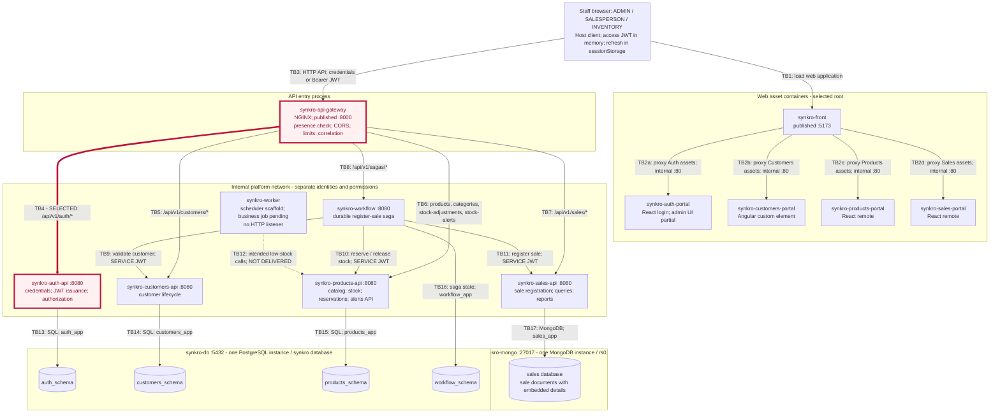
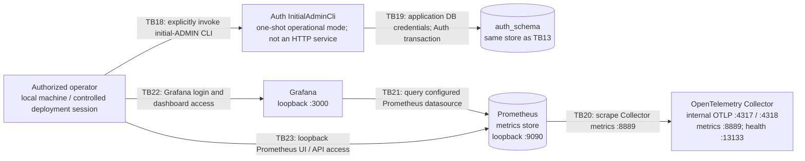

# CP1 - Attack Surface Map

- Author: Angel Gustavo Solano Trujillo (@AsolanoT)
- Team: synkro-tech
- Claimed boundary: **TB4 - synkro-api-gateway -> synkro-auth-api**
- Claim: [Issue #268](https://github.com/code-corhuila/synkro-docs/issues/268)
- Documentation reviewed: 2026-10-29

## 1. Scope and evidence

For this map, I use the roles and architecture described in `synkro-docs`, together with the Auth and Gateway configuration. The map shows how requests and data move through the system. It is based on documentation and source review.

The system is used by employees with the roles ADMIN, SALESPERSON and INVENTORY. Customers are the buyers whose information we record; they do not log into this MVP. Our four domain APIs are Auth, Customers, Products and Sales. Gateway handles incoming API traffic, Workflow coordinates the sale, and Worker is intended to run scheduled tasks.

**Broker and external APIs:** As a team, we deferred the broker and outbox in [ADR-007, Decision 5](https://github.com/code-corhuila/synkro-docs/blob/main/05-architecture/decisions/records/ADR-007-persistent-saga-and-scheduled-work.md#decision-5--rabbitmq-the-outbox-and-salecompleted-deferred-out-of-the-mvp) because no MVP requirement needs an event consumer; REST and the saga cover our current flow.
External APIs are also outside our [MVP scope](https://github.com/code-corhuila/synkro-docs/blob/main/01-context/scope.md#external-integrations), so payment and notification integrations are not included.

**Delivery limits:** Worker has a scheduler, but the low-stock job that calls Products is still pending. The full infrastructure setup and monitoring tools are documented as candidates. For business scope I use the product vision; for the current delivery status I use architecture, deployment and the service catalog, since the vision's roadmap is older.

## 2. System data-flow diagram

The arrows show where requests or data go. Responses, including access and refresh tokens, return through the same path. I marked my boundary, TB4, in red with a thicker arrow. Dashed arrows show planned calls that are not implemented yet.

The browser runs the Host's shared HTTP client and session code. The `synkro-front` container serves the web application and proxies the portal files. The portals use the Host's session and client, so they do not each store their own tokens or make separate API connections.

Gateway and Host publish the business application's ports. The APIs and Workflow use internal port **8080**, the portal containers use **80**, PostgreSQL uses **5432**, and MongoDB uses **27017**. The selected setup excludes the incompatible Products Portal tag that publishes 5175; it does not add another public portal.

The local setup uses HTTP. Gateway forwards Auth requests to `http://synkro-auth-api:8080`, and TLS or mTLS on TB4 has not been demonstrated. Our security policy requires HTTPS outside local development, but that requirement still needs a configured deployment.

### Operational and monitoring surface

The infrastructure documentation also includes administrator initialization and monitoring tools. I included them because they provide access to accounts or system information, even though they are outside the Auth routes in TB4.

InitialAdminCli runs the existing Auth application in an operational mode to create the first administrator. An authorized operator invokes it directly. It has no public HTTP endpoint and is separate from normal user registration, which requires an ADMIN.

Collector, Prometheus and Grafana are part of the candidate setup. Service OTLP exporters, spans and complete business/database metrics still need verification. Collector ports are internal, while Prometheus and Grafana bind to loopback. Grafana reads its administrator password from a configured file. The documents do not establish application authentication for Prometheus, and loopback access by itself does not identify a user. A durable central log or trace store is also pending.

## 3. Trust-boundary register

A trust boundary appears when data passes to code, a service or a store with different permissions. Two services can share the same Docker network and still need to verify each other's requests.

| ID | Crossing | Trust decision / data crossing |
|---|---|---|
| TB1 | Staff browser <-> Host web server | The login application and static files load before authentication. Input and browser state still need validation. |
| TB2a-TB2d | Host asset proxy <-> four portal containers | Each portal supplies executable UI files. Once loaded, those files share the browser context; the portals are not isolated browser sandboxes. |
| TB3 | Host client in browser <-> Gateway | Credentials, tokens, business data and headers enter the API network. The caller controls the input. CORS and a nonempty Authorization header do not prove identity. |
| **TB4 - mine** | **Gateway <-> Auth** | **Passwords, refresh tokens, ADMIN requests and token responses cross this boundary. Auth checks credentials and permissions instead of trusting the internal network or `X-User-*` headers.** |
| TB5 | Gateway <-> Customers | Customers validates the token and permissions before reading or changing customer personal information. |
| TB6 | Gateway <-> Products | Products checks the role required for catalog reads, catalog changes and stock adjustments. Passing through Gateway does not authorize the operation. |
| TB7 | Gateway <-> Sales | Sales checks access to queries and reports separately from sale registration, which requires a SERVICE token. |
| TB8 | Gateway <-> Workflow | Workflow receives the initiating person's JWT, the sale request and its idempotency key before starting the saga. |
| TB9 | Workflow <-> Customers | Workflow uses its SERVICE token with `customers:read` to check that the customer is active. |
| TB10 | Workflow <-> Products | Workflow needs `stock:reserve` or `stock:release`. The requests carry quantities, and the reservation response returns frozen prices. |
| TB11 | Workflow <-> Sales | Workflow needs `sales:register` and sends customerId, createdBy, reserved lines and frozen prices. Sales calculates the totals. |
| TB12 - planned | Worker <-> Products | The planned job needs `products:read`, `stock-alerts:read` and `stock-alerts:write`. The scheduler exists, but this business job is pending. |
| TB13 | Auth <-> auth_schema | Auth connects as `auth_app` to access users, refresh hashes, service-token metadata, idempotency records and user-creation audit records. |
| TB14 | Customers <-> customers_schema | Customers connects as `customers_app` to access its customer data. |
| TB15 | Products <-> products_schema | Products connects as `products_app` to access catalog, stock, reservations and alerts. |
| TB16 | Workflow <-> workflow_schema | Workflow connects as `workflow_app` to save saga state, execution evidence and the initiating person's identity. |
| TB17 | Sales <-> MongoDB sales | Sales uses `sales_app` with restricted access to its database. It does not use the migration administrator's credentials. |
| TB18-TB19 | Operator -> initial-admin CLI -> Auth store | Access to the executable and its configuration lets an authorized operator create the first administrator. This operation is not available through an unauthenticated web route. |
| TB20-TB21 | Collector <-> Prometheus <-> Grafana | Metrics cross between collection, storage and dashboard tools. Their connection still needs to be distinguished from complete service instrumentation. |
| TB22-TB23 | Operator <-> Grafana / Prometheus | These interfaces expose operational information. Grafana requires administrator authentication. Prometheus binds to loopback, while additional application authentication remains unverified. |

### Boundaries that must also be considered during review

- The operator configures the private signing key only in Auth and the public verification key in the services that validate JWTs. Application and migration database credentials are separate. This configuration is a privileged entry point. Services validate JWTs locally, without calling Auth or an external identity provider for each request.
- Browser memory and sessionStorage share the page's JavaScript context. An injected script or a compromised portal could read session credentials.
- Auth, Customers, Products and Workflow use separate schemas in one PostgreSQL database. Their users and grants limit access, but a privileged database administrator and an engine failure can affect several services. The map does not include cross-schema joins.
- Migrations, database bootstrap, physical volumes and backups require operator control. Tooling uses credentials with more privileges than the application users. No separate backup service is documented.
- Logs and metrics must leave out passwords, tokens and request bodies. Durable central log and trace storage still need to be established.
- This MVP has no broker, queues, topics or external business API. A future integration would need its own boundaries for producers, consumers or external providers.

## 4. Asset inventory

I classified the assets by how they should be handled: `public` data can be exposed without authentication, `internal` data is for the team or company, `confidential` data includes personal and sensitive business information, and `restricted` data includes credentials or material that grants access. This is the classification used for the workshop; it is not automated in the application. Business data remains sensitive in an academic project.

### Auth assets - selected domain

| ID | Asset | Where it lives / moves | Classification | Why |
|---|---|---|---|---|
| A1 | Login passwords and new-user passwords | Browser input, request bodies on TB3/TB4 and temporary Auth memory. Only the bcrypt hash is stored. | restricted | Someone who obtains a password could take over the account. |
| A2 | Stored password hashes | `auth_schema.system_user.password_hash`, accessed through TB13. | restricted | Password hashes are still sensitive credential data. |
| A3 | Human access JWTs | Auth responses through TB4/TB3, Host-managed browser memory and Authorization headers sent to protected APIs. | restricted | Someone holding a valid Bearer token can act with its permissions until it expires. |
| A4 | Refresh credentials and their stored hashes | The usable token is in Host-managed sessionStorage and refresh/logout requests. Its hash is stored in `auth_schema.refresh_token`. | restricted | It can renew a session. The usable token and the database hash are different forms of the credential. |
| A5 | RS256 private signing key | Auth's runtime configuration or secret file, used by the signing adapter. | restricted | Someone with this key can forge tokens. It must stay out of other APIs and the fork. |
| A6 | SERVICE JWTs for Workflow and Worker | Auth returns a token once to an ADMIN through TB4/TB3. It is configured as that service's `SERVICE_TOKEN`. `auth_schema.service_token` stores metadata only. | restricted | These tokens authorize internal stock and sale operations. Worker's business calls are still pending. |
| A7 | User names, emails, active status and role assignments | Auth requests/responses and `auth_schema.system_user`. | confidential | They contain personal information and determine what a user can do. Access must be authorized. |
| A8 | User-creation attribution | `auth_schema.user_creation_audit`, with actor, subject, time and correlation. | confidential | It records who created an account and must be protected from changes. It must not contain passwords or tokens. |
| A9 | Auth idempotency records | `auth_schema.idempotency_key` and keys sent for registration or service-token issuance. | internal | They prevent duplicate creation. Knowing a key does not grant access to an operation. |

### Other system assets needed to understand the complete flow

| ID | Asset | Where it lives / moves | Classification | Why |
|---|---|---|---|---|
| A10 | Customer identity document, name and contact details | Customers requests/responses and `customers_schema`. | confidential | They identify buyers and contain personal information. |
| A11 | Catalog, stock levels, adjustments and reservations | Products API and `products_schema`; reservation results also pass to Workflow. | internal | Prices and stock affect daily operations and the correctness of sales. |
| A12 | Sales, customer references, frozen prices and totals | Workflow calls to Sales, MongoDB `sales` database and Sales queries/reports. | confidential | They contain commercial information and references to buyers. |
| A13 | Saga state and recovery evidence | Workflow memory and persistent `workflow_schema`. | internal | Changing this data could cause an unsafe retry or release reserved stock incorrectly. |
| A14 | Application and migration database passwords / connection secrets | Configuration supplied by the operator to each service or tooling process. | restricted | They give different levels of database access and must be kept separate. |
| A15 | Metrics and sanitized operational logs | Collector/Prometheus, service output and controlled operator collection. Durable central log storage is unverified. | internal | They reveal system behavior and topology even when sensitive values are removed. |
| A16 | Static login application / portal bundles without secrets | Host and portal containers, delivered before the browser user authenticates. | public | The login page must load before sign-in. These files need integrity protection and must not include secrets. |

A1, A3, A4, A6, A7 and A9 cross TB4 directly. A2, A5 and A8 stay behind Auth, but accepting an unauthorized request could still put them at risk.

## 5. Entry points of TB4 - Gateway -> Auth

### Common request path, ports and caller

`Browser / Host shared client -> Gateway :8000 -> synkro-auth-api :8080`.

At TB4, Gateway is the process that calls Auth. The request starts with a person or, for login and refresh, someone who does not yet need an access JWT. Gateway forwards the request without a separate gateway service token or a demonstrated mTLS identity. Auth checks the credentials required by each endpoint.

A direct call to Auth on internal port 8080 would skip Gateway controls, so Auth must apply its validation independently. Gateway has exact public routes for login and refresh, checks that Authorization is present on protected routes, and answers OPTIONS itself. Auth's filter allows login, refresh and health without a prior JWT, reads Bearer tokens, ignores `X-User-*` headers and passes authorization decisions to the use cases. These details come from source review rather than a new runtime test.

| Endpoint forwarded across TB4 | Logical caller | Data crossing | Authentication and authorization in the current contract / inspected source |
|---|---|---|---|
| `POST /api/v1/auth/login` | Employee or unauthenticated attacker | Email/password; access and refresh tokens in the response. | No prior Bearer JWT is required. Auth checks the credentials and that the user is active. Invalid credentials return a generic 401. Gateway limits login attempts per IP. |
| `POST /api/v1/auth/refresh` | Refresh-token holder, normally through the Host | Refresh token in the body; a new token pair in the response. | No Bearer header is required. Auth checks the refresh token's owner, expiry and state, then rotates it. This public route still requires a valid refresh credential. |
| `POST /api/v1/auth/register` | Human ADMIN | Name, email, password, requested person role and Idempotency-Key; created user in the response. | Gateway requires a nonempty Authorization header. Auth validates the JWT and requires a trusted human ADMIN before lookup, replay or persistence. Missing/invalid token: 401. Valid non-ADMIN or SERVICE caller: 403. |
| `POST /api/v1/auth/logout` | Authenticated ADMIN, SALESPERSON or INVENTORY | Person access JWT and the submitted refresh token. | Auth validates the person token and the logout permissions. SERVICE callers are refused. Logout invalidates the submitted usable refresh token belonging to the caller; an issued access JWT can remain valid until expiry. |
| `GET /api/v1/auth/users/{id}` | Human ADMIN | Access JWT and target UUID; user data without password/hash in the response. | Auth validates the JWT and checks ADMIN access. A valid signature alone does not authorize the lookup. |
| `POST /api/v1/auth/service-tokens` | Human ADMIN | Service name and Idempotency-Key; a SERVICE JWT in the first response. | Auth validates the ADMIN caller. Permissions come from the fixed service configuration, not the request. A replay returns metadata without returning the token again. |
| `GET /api/v1/auth/service-tokens/{id}` | Human ADMIN | Access JWT and token UUID/jti; token metadata in the response. | Auth validates the ADMIN caller. The response does not contain the signed service token. |

Registration and service-token issuance require `Idempotency-Key`; the other Auth operations do not. `X-Correlation-Id` helps follow a request through logs and responses. It does not establish identity or permission.

### Adjacent entry points that do not cross TB4

| Entry point | Port / caller | Current authentication and boundary |
|---|---|---|
| Auth `GET /health` | Internal Auth :8080; operator/internal health probe | It requires no token within the internal network. The effective path is `/health`, not `/api/v1/health`. The inspected Gateway has no Auth health proxy route. |
| Gateway `GET /health` | Published Gateway :8000 | Gateway answers this public request locally. It does not check Auth connectivity or the health of the complete system. |
| `OPTIONS /api/v1/auth/...` | Gateway :8000; browser CORS preflight | Gateway returns 204 before checking credentials and does not forward the request to Auth. |
| Auth InitialAdminCli | Authorized operator execution; no HTTP listener | It uses the environment/configuration and Auth database to initialize the first ADMIN. It is not a public registration or account-recovery API. |
| Queues / topics / broker listener | Not applicable | The MVP uses no broker or asynchronous transport. |

### Known limits to carry into CP2

- Gateway checks that credentials are present on protected routes. Auth must verify the JWT itself.
- The local connection on TB4 uses HTTP. mTLS and a separate cryptographic identity for Gateway have not been demonstrated.
- Login and refresh are public routes that carry restricted data. They still need credential checks, input validation and appropriate rate controls.
- Refresh rotation and logout affect stored refresh credentials. They do not immediately revoke issued person or SERVICE JWTs. ADR-017 and the security policy define the exact scope; the broad refresh-reuse wording in OpenAPI must be read with those limits.
- Source review does not verify a complete running deployment. Nonlocal TLS, progressive account lockout, complete telemetry, a token denylist and the Worker's business job still need separate evidence.

## 6. Traceability and source references

The map connects our product goals to the components that handle each piece of data: roles control access, Customers owns buyer information, Products owns inventory, and Sales records transactions. The domain catalog defines the entities and rules, while the architecture and API contracts define the service boundaries.

The references below are from our team's documentation:

| Source | Used for |
|---|---|
| [Product vision](https://github.com/code-corhuila/synkro-docs/blob/main/03-product/vision.md) and [problem framing](https://github.com/code-corhuila/synkro-docs/blob/main/03-product/problem-framing.md) | Employee roles and business scope. Current delivery status comes from the architecture documents rather than the older roadmap. |
| [Domain map](https://github.com/code-corhuila/synkro-docs/blob/main/02-domain/domain-map.md) and [entities and rules](https://github.com/code-corhuila/synkro-docs/blob/main/02-domain/entities-and-rules.md) | Contexts, entities and business rules. |
| [Architecture overview](https://github.com/code-corhuila/synkro-docs/blob/main/05-architecture/overview.md) and [service catalog](https://github.com/code-corhuila/synkro-docs/blob/main/09-microservices/service-catalog.md) | Seven backend/cross-cutting components, five web containers, Worker's pending job and the absence of broker/external APIs. |
| [Deployment](https://github.com/code-corhuila/synkro-docs/blob/main/05-architecture/deployment.md) | Published/internal ports, shared database instances, candidate setup and administrator initialization. |
| [Data models](https://github.com/code-corhuila/synkro-docs/blob/main/06-data/models.md) | Store ownership, database users and Auth asset locations. |
| [Auth OpenAPI contract](https://github.com/code-corhuila/synkro-docs/blob/main/07-api/contracts/openapi/synkro-auth-api.yaml) | Seven Auth operations, request/response data and the health-path exception. |
| [Authentication strategy](https://github.com/code-corhuila/synkro-docs/blob/main/07-api/authentication.md) and [security policy](https://github.com/code-corhuila/synkro-docs/blob/main/00-governance/security-policy.md) | Local JWT validation, browser storage, service permissions and token-revocation limits. |
| [Decision register](https://github.com/code-corhuila/synkro-docs/blob/main/05-architecture/decisions/README.md) | ADR-006, ADR-007, ADR-009, ADR-010, ADR-012, ADR-014, ADR-016 and ADR-017. |
| [Observability](https://github.com/code-corhuila/synkro-docs/blob/main/13-operations/observability.md) | Collector, Prometheus, Grafana, operator access and pending exporter/log/trace coverage. |

## 7. Completion checks

- [x] The map includes the product's users, business services and their stores.
- [x] It also includes the frontend containers and documented monitoring tools.
- [x] It identifies the absent broker/external APIs and the Worker's planned calls.
- [x] Each trust boundary has an ID, and TB4 is marked in red.
- [x] The inventory lists and classifies at least five Auth assets.
- [x] The Auth entry points include their ports, callers and authentication requirements.
