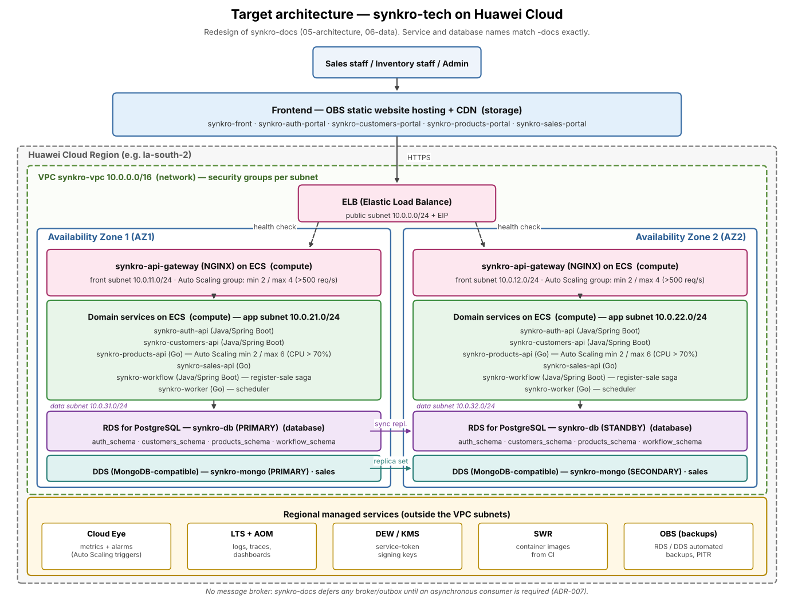

# Architecture design note — synkro-tech

## 1. Target architecture

The diagram above redesigns the system documented in our team's `-docs` repository (`05-architecture/overview.md`) for deployment on Huawei Cloud. It keeps every service, database and naming convention identical to `-docs` — nothing was renamed — and places each one on a Huawei Cloud component, spread across two Availability Zones (AZ1, AZ2) inside one region. The system currently has no message broker: `-docs` explicitly defers any broker/outbox pattern until a requirement needs an asynchronous consumer (ADR-007), so none is forced into this diagram either.

The network layer follows the multi-subnet pattern from chapter 5 (Cloud Network Solution Design): one VPC, `synkro-vpc` (10.0.0.0/16), with a public subnet that only holds the ELB and its EIP, and three private subnets per Availability Zone: front (the gateway), app (the six domain services) and data (RDS and DDS). Each subnet has its own security group, so the data subnet only accepts PostgreSQL and MongoDB traffic from the app subnet and nothing from the Internet. The five frontend portals are static builds, so they leave the compute layer entirely and are served from OBS static website hosting behind CDN. Regional managed services (Cloud Eye, LTS, AOM, DEW/KMS, SWR and OBS for backups) sit outside the subnets.

| Component in the diagram | Defined in (file of your team's -docs) |
|---|---|
| `synkro-front`, `synkro-auth-portal`, `synkro-customers-portal`, `synkro-products-portal`, `synkro-sales-portal` | `05-architecture/overview.md` §3 (C4 Level 2 — Containers, frontend subgraph) |
| `synkro-api-gateway` | `05-architecture/overview.md` §4 (Service Catalog #5) and P3 |
| `synkro-auth-api` | `05-architecture/overview.md` §4 (#1); `09-microservices/services/01-auth-api/README.md` |
| `synkro-customers-api` | `05-architecture/overview.md` §4 (#2); `09-microservices/services/02-customers-api/README.md` |
| `synkro-products-api` | `05-architecture/overview.md` §4 (#3); `09-microservices/services/03-products-api/README.md` |
| `synkro-sales-api` | `05-architecture/overview.md` §4 (#4); `09-microservices/services/04-sales-api/README.md` |
| `synkro-workflow` | `05-architecture/overview.md` §4 (#6); `09-microservices/services/06-workflow/README.md` |
| `synkro-worker` | `05-architecture/overview.md` §4 (#7); `09-microservices/services/07-worker/README.md` |
| `synkro-db` (PostgreSQL: `auth_schema`, `customers_schema`, `products_schema`, `workflow_schema`) | `05-architecture/overview.md` P2; `06-data/data-dictionary.md`; `ADR-009-shared-instance-schema-per-domain.md` |
| `synkro-mongo` (on DDS, `sales` database) | `05-architecture/overview.md` P2; `ADR-010-sales-on-mongodb.md` |

The cloud components in the diagram (VPC, subnets, ELB, OBS/CDN, Cloud Eye, LTS, AOM, DEW/KMS, SWR) are not defined in `-docs`; they are the placement chosen in this note, and each one is justified in sections 2 to 5.

## 2. Five principles

Our team's own non-functional requirements document (`04-requirements/non-functional.md`) is unusually explicit about which qualities are already decided and which are only "aspirational" because the MVP runs on a single developer's Docker Compose instance with no cloud environment. That gap is the real starting point for this redesign: every weakness below is quoted from our own documentation, not invented for this exercise.

| Principle | Current weakness | Evidence in -docs | Design decision | Huawei Cloud service |
|---|---|---|---|---|
| Reliability | The single shared PostgreSQL instance is a documented single point of failure for Auth, Customers, Products and the saga store (AT-002, risk accepted in ADR-009 because the MVP runs on Compose) | `05-architecture/overview.md` §9 (AT-002); `ADR-009-shared-instance-schema-per-domain.md` | Replace the single instance with RDS for PostgreSQL in Multi-AZ mode, synchronous replication to a standby in AZ2 | RDS for PostgreSQL (Multi-AZ) |
| Security | Service tokens used for internal calls (gateway→service, workflow→participants) are rotated by hand every 30 days (AT-005) | `05-architecture/overview.md` §9 (AT-005) | Store and auto-rotate the service-token signing keys in a managed key vault instead of a manual calendar task | Data Encryption Workshop (DEW) / Key Management Service (KMS) |
| Performance efficiency | NFR-001 states no capacity planning exists: "Minimum throughput / max RPS: Not yet defined — No capacity planning done"; P95 targets are only a proposed default, never load-tested | `04-requirements/non-functional.md` (NFR-001) | Add metric-driven Auto Scaling to the two services on the critical sale path (detailed in §3) instead of fixed-size containers | Auto Scaling + Cloud Eye |
| Cost | NFR-003 Scalability is "entirely aspirational" because the only adopted infrastructure is Docker Compose on one machine — any real deployment today would have to size every service for peak load, all the time | `04-requirements/non-functional.md` (NFR-003) | Run the stateless services (gateway, 4 domain APIs, workflow, worker) on pay-per-use ECS behind Auto Scaling so idle capacity is released off-peak | Auto Scaling + ECS (pay-per-use) |
| Operations | NFR-005 states structured logging, dashboards, metrics, distributed tracing and alerting are "not certified" and remain aspirational beyond basic security-event logs | `04-requirements/non-functional.md` (NFR-005) | Centralize logs, metrics and traces instead of leaving each service to its own console output | Log Tank Service (LTS) + Cloud Eye + Application Operations Management (AOM) |

## 3. Scalability

`synkro-products-api` is the service our own technology decision record singles out for "high-frequency reads" (`01-context/overview.md`, cited in NFR-001) — it is called on every single sale to check stock and price, making it the clearest horizontal-scaling candidate on the X axis of the AKF Scale Cube. `synkro-api-gateway` is the second candidate because `-docs` itself flags it as the one component whose failure takes down the entire system (AT-004): scaling it removes that single point of failure instead of only documenting it.

| Service | Scaling metric | Threshold (number and unit) | Min instances | Max instances |
|---|---|---|---|---|
| `synkro-products-api` | Average CPU utilization (Cloud Eye alarm policy) | CPU > 70% for 5 consecutive minutes | 2 | 6 |
| `synkro-api-gateway` | Request rate per instance (Cloud Eye alarm policy) | > 500 requests/second sustained for 3 minutes | 2 | 4 |

Both groups keep a minimum of 2 instances spread across AZ1 and AZ2 at all times, so a single-AZ fault never drops a service to zero running instances — this is also what makes the Disaster Recovery numbers in §4 achievable for the compute layer, not only for the databases.

Three settings keep these policies from misbehaving. First, both scaling groups use a 300-second cooldown period, so one alarm cannot launch a new instance while the previous one is still starting. Second, each group uses the ELB health check instead of the plain ECS check, so an instance whose process has died but whose VM is still running gets replaced. Third, scale-in uses the oldest-instance-first removal policy with AZ balancing, so after a spike the group shrinks evenly and never leaves both instances in the same AZ. Both services can scale this way only because they are stateless: tokens are validated on every request and all state lives in `synkro-db` or `synkro-mongo`.

## 4. Disaster recovery

- **Critical data store:** `synkro-db`, the shared RDS for PostgreSQL instance — chosen because it is the one our team's own documentation already flags as a single point of failure affecting four of our five domains (AT-002), not a secondary store.
- **RTO target:** 5 minutes.
- **RPO target:** 1 minute.
- **DR pattern (chapter 11):** On-Cloud Intra-Region Active-Active DR (cross-AZ RDS Multi-AZ deployment with ELB health-check-based failover).
- **Why the pattern meets those numbers:** RDS for PostgreSQL in Multi-AZ mode replicates every committed transaction synchronously to the standby in AZ2 before confirming the commit, so an AZ1 failure loses no committed sale, customer or product row and the real RPO is 0 minutes, inside the 1-minute target. RDS detects the failed primary and promotes the standby automatically while the ELB health checks stop sending application traffic to the failed AZ, so recovery is a connection failover measured in seconds (the course rates this pattern's RTO as almost zero) and not a backup restore, which is why it fits the 5-minute RTO that a cold-standby pattern built on daily backups could never meet.
- **Supporting measures:** `synkro-mongo` gets the same treatment on DDS (a replica set across AZ1 and AZ2), and both databases keep automated backups in OBS with point-in-time recovery, because synchronous replication would also copy a wrong `DELETE` to the standby: replication protects against losing an AZ, backups protect against logical errors.

## 5. Automated deployment

| Stage | Trigger | Tool or service | File in your team's repositories |
|---|---|---|---|
| Build | Push or PR to `develop`, `qa` or `main` | Maven (`auth-api`, `customers-api`, `workflow`) / Go build (`products-api`, `sales-api`, `worker`) | `synkro-products-api/.github/workflows/ci.yml` |
| Test | Same trigger, same workflow run | Go vet/unit tests and architecture guard, or Maven verify, per service | `synkro-sales-api/.github/workflows/ci.yml` |
| Image | After tests pass | Docker build of the service image | `synkro-products-api/Dockerfile` |
| Deploy to qa | Push/merge to the `qa` branch | Existing CI job set, extended with a Huawei Cloud CodeArts deploy step (proposed) | `synkro-products-api/.github/workflows/ci.yml` (extend) |
| Deploy to production | Push/merge to `main`, gated by CODEOWNERS review (`00-governance/git-conventions.md`) | Huawei Cloud CodeArts Pipeline deploying the RFS template | `infra/huawei-rfs/main.tf` (proposed, new) |
| Rollback | Failed Cloud Eye health check after a production deploy | CodeArts Pipeline rollback to the previous image tag behind the ELB | `infra/huawei-rfs/main.tf` (proposed, new — rollback stage) |

Build, test and image stages already exist today, per service, in the real `ci.yml` workflows our team maintains (`10-devops/ci-cd.md`). The qa/production/rollback stages are this exercise's proposal: our current pipeline builds and tests containers but, by our own `ci-cd.md`'s own words, "no complete hosted automatic deployment is evidenced by this snapshot" — so these three stages close that gap using Huawei Cloud's RFS/CodeArts tooling from chapter 12 instead of inventing an unrelated tool.

Rollback is kept simple on purpose: every image is tagged with its commit SHA and pushed to SWR, so rolling back means redeploying the previous tag, not rebuilding code. The production stage only moves ELB traffic to the new instances after they pass the health check, and if the Cloud Eye alarm on HTTP 5xx errors fires during the first ten minutes, the pipeline redeploys the last good tag automatically.

## 6. Decisions

- [ADR-C3-01](ADR-C3-01.md): adopt RDS for PostgreSQL in Multi-AZ mode for `synkro-db`, replacing the single documented point of failure (AT-002).
- [ADR-C3-02](ADR-C3-02.md): adopt Cloud-Eye-driven Auto Scaling for `synkro-products-api` and `synkro-api-gateway`.
